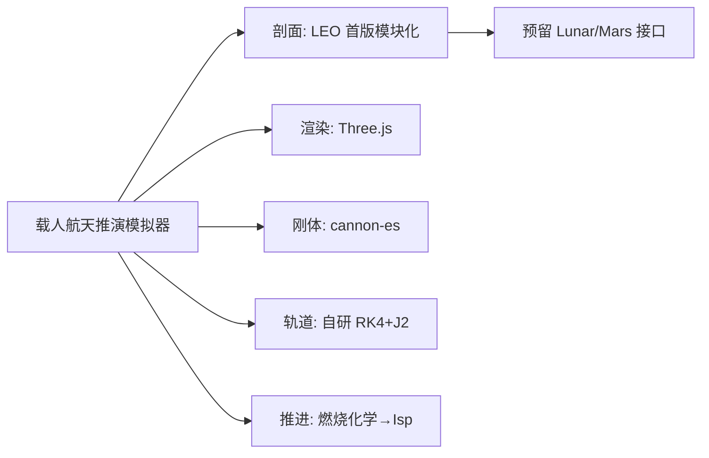

# Tech stack

## Technology choices

|domain|candidates|decision|rationale|
|---|---|---|---|
|build|Vite / no framework|Vite + native ES modules|YAGNI, zero heavy deps|
|3D render|Three.js r16x|Three.js|mature browser 3D, physics-engine ecosystem|
|rigid body|cannon-es / Rapier|canon-es|lightweight pure-JS, mature Three.js integration|
|orbital mechanics|game engine / self-built integrator|self-built RK4 + J2 + patched conic|game engines are wrong tool for orbital physics; fidelity requirement|
|propulsion|hand-entered Isp / combustion chemistry|self-built combustion + nozzle aero calc|"所有数据必须符合物理"; Isp derived, not typed|
|state|Redux etc / minimal store|minimal self-built store|no framework, YAGNI|
|test|—|Vitest for pure physics modules|rocket equation, Isp, orbit, risk/cost formulas|

## Decision mindmap

## Open items

- 轨道积分器验证 400km 圆轨道速度误差
